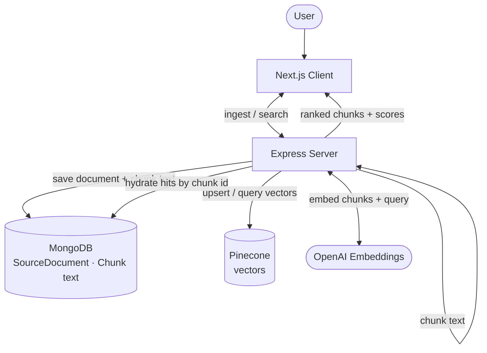

# Semantic Search Engine

> Project 2 of my Agentic AI build series — ingest documents, embed chunks, and search by **meaning**, not keywords.

**Search only — no RAG.** The app returns ranked passages with scores and sources. It does **not** generate answers from those chunks (that’s Project 3).

---

## Architecture



---

## Features

- **Three ingest paths:** upload a file (`.txt` / `.md` / `.pdf`), paste a public URL, or paste plain text
- **Chunk + embed pipeline:** overlapping text windows → OpenAI `text-embedding-3-small` (1536-d)
- **Split storage:** MongoDB holds document metadata and chunk text; Pinecone holds vectors (same chunk ids)
- **Semantic search API:** embed the query → Pinecone top-k → hydrate passages from Mongo → ranked scores in the UI
- **Inspectable results:** source badges (File / Url / Text), similarity scores, and chunk text

---

## Tech stack

| Layer        | Tech                                                        |
| ------------ | ----------------------------------------------------------- |
| Frontend     | Next.js 16, React 19, TypeScript, Tailwind CSS              |
| Backend      | Node.js, Express 5, TypeScript                              |
| AI           | OpenAI API (`text-embedding-3-small`)                       |
| Database     | MongoDB Atlas, Mongoose                                     |
| Vector store | Pinecone (dense, cosine, 1536 dims)                         |
| Ingest       | multer, pdf-parse, html-to-text                             |

---

## Local setup

### Prerequisites

- Node.js 20+
- MongoDB Atlas free cluster (or local MongoDB)
- OpenAI API key with credits
- Pinecone index (dense, **1536** dimensions, **cosine** similarity)

### 1. Clone

```bash
git clone https://github.com/jalvaradoas39/semantic-search-engine.git
cd semantic-search-engine
```

### 2. Server

```bash
cd server
npm install
cp .env.example .env
# Fill in MONGODB_URI, OPENAI_API_KEY, CLIENT_URL,
# PINECONE_API_KEY, PINECONE_INDEX, PINECONE_INDEX_HOST
npm run dev           # Starts on http://localhost:4000
```

### 3. Client

```bash
cd client
npm install
cp .env.local.example .env.local
# NEXT_PUBLIC_API_URL=http://localhost:4000 (already set)
npm run dev           # Starts on http://localhost:3000
```

### Useful server scripts

| Script          | What it does                  |
| --------------- | ----------------------------- |
| `npm run dev`   | Start Express with hot reload |
| `npm run build` | Compile TypeScript to `dist/` |
| `npm run start` | Run compiled server           |

---

## Project structure

```
semantic-search-engine/
├── client/                   # Next.js frontend
│   └── src/
│       ├── app/
│       │   ├── page.tsx              # Home: ingest + search panels
│       │   ├── layout.tsx            # Brand shell + fonts
│       │   └── globals.css           # Signal-atlas theme
│       ├── components/
│       │   ├── IngestForm.tsx        # File / URL / paste ingest
│       │   └── SearchForm.tsx        # Query + ranked hit cards
│       └── lib/
│           └── api.ts                # fetch helpers and types
│
└── server/                   # Express backend
    └── src/
        ├── index.ts                  # App entry — middleware + routes
        ├── lib/
        │   ├── db.ts                 # Mongoose connection
        │   ├── openai.ts             # OpenAI client
        │   ├── pinecone.ts           # Pinecone index client
        │   ├── chunkText.ts          # Overlapping chunk windows
        │   ├── embedTexts.ts         # Batch embeddings helper
        │   ├── extractPdfText.ts     # PDF → plain text
        │   └── fetchUrlText.ts       # URL → plain text
        ├── models/
        │   ├── SourceDocument.ts     # Parent document metadata
        │   └── Chunk.ts              # Chunk text (+ link to document)
        ├── routes/
        │   ├── ingest.ts             # POST /api/ingest, /file, /url
        │   └── search.ts             # POST /api/search
        └── services/
            ├── ingestService.ts      # Chunk → embed → Mongo + Pinecone
            └── searchService.ts      # Embed query → Pinecone → hydrate
```

---

## Key concepts practiced

| Concept                    | Where                                                                 |
| -------------------------- | --------------------------------------------------------------------- |
| Embeddings                 | `embedTexts.ts` — OpenAI `text-embedding-3-small`                     |
| Chunking with overlap      | `chunkText.ts` — ~800-char windows, 100-char overlap                  |
| Vector index tradeoffs     | In-app cosine first for learning → Pinecone for scalable ranking      |
| Split storage              | Mongo = readable text; Pinecone = vectors; shared chunk ids           |
| Multi-source ingest        | `routes/ingest.ts` — paste, file (multer/pdf-parse), URL              |
| Similarity search          | `searchService.ts` — Pinecone `query` + Mongo hydrate                 |
| Thin routes / thick services | HTTP in `routes/`; OpenAI + DB + Pinecone logic in `services/`      |
| Product boundary           | Retrieval only — no generated answers (RAG is Project 3)              |

---

## Scope boundary

| In scope                        | Out of scope (later projects)        |
| ------------------------------- | ------------------------------------ |
| Ingest → chunk → embed → search | Grounded Q&A / citations (Project 3) |
| Ranked chunks + scores in the UI | Tool calling, agents (Projects 4+)  |

---

## Demo

YouTube: *(add link after publishing)*

GitHub: [github.com/jalvaradoas39/semantic-search-engine](https://github.com/jalvaradoas39/semantic-search-engine)
